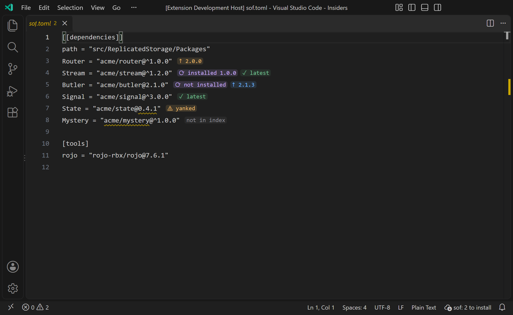
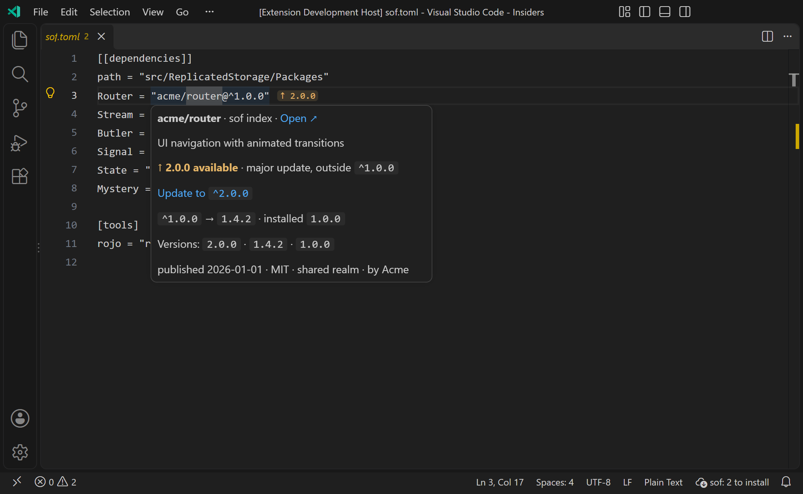
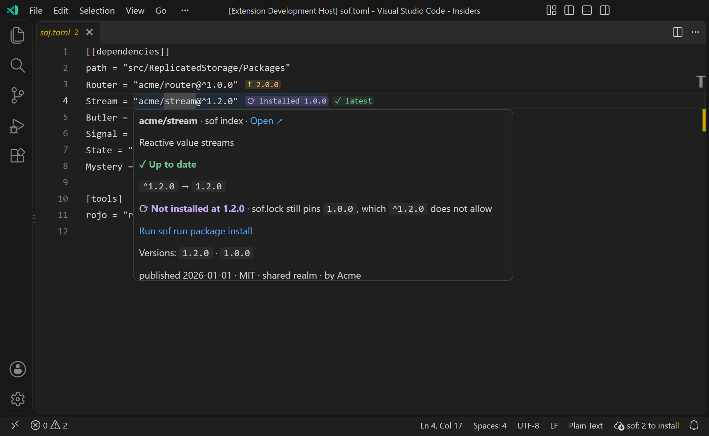
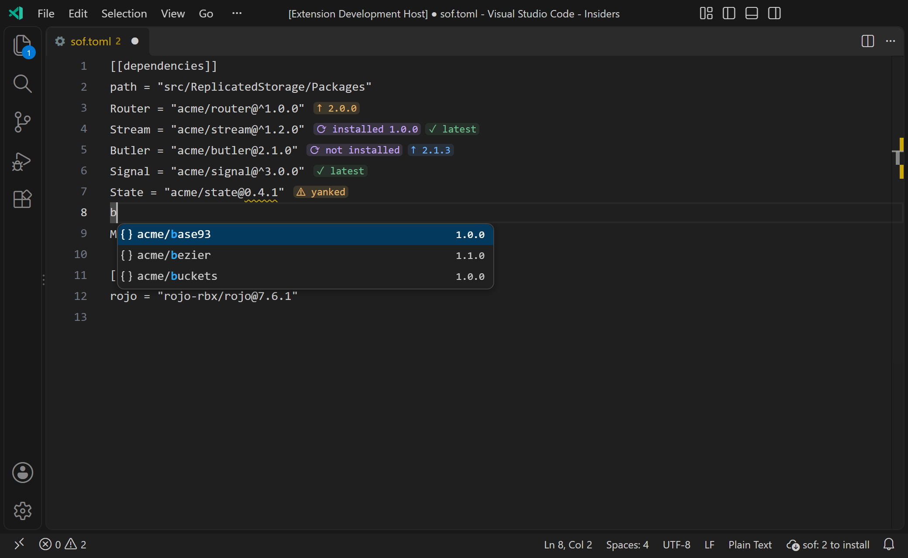
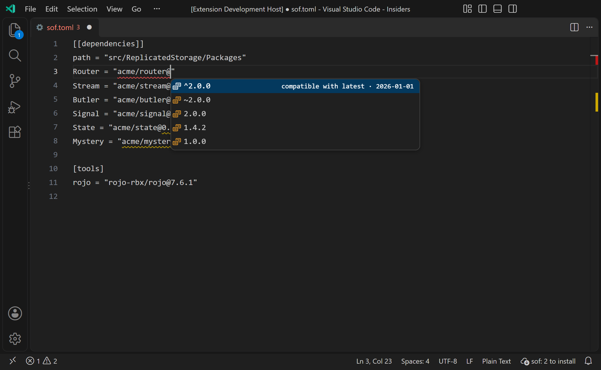
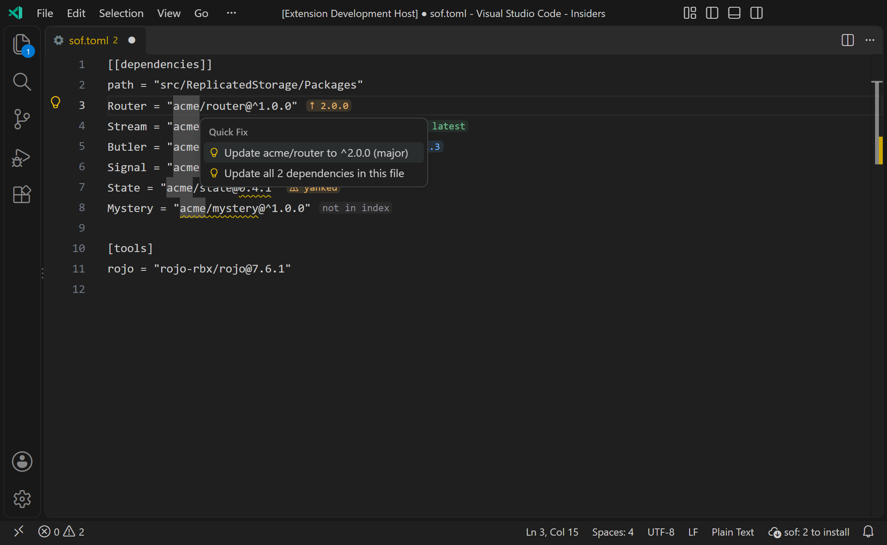

# sof for VS Code and Cursor

Editor support for [sof](../../README.md) project files. It reads every `sof.toml`, `.sof.toml` and `*.sof.toml` (such as `packages.sof.toml`) and checks each package against the [sof package index](https://sof.sov.gg).



## What you get

**Tags after each dependency** say what the index knows:

| Tag | Meaning |
| --- | --- |
| `✓ latest` | Nothing newer exists. |
| `↑ 1.4.2` (blue) | A newer minor or patch version exists. |
| `↑ 2.0.0` (amber) | A newer major version exists. |
| `✗ no match` | No published version satisfies the range, so `sof run package install` would fail. |
| `✗ yanked` | Every version the range matches has been yanked. |
| `⚠ yanked` | The version `sof.lock` pins was yanked after you installed it. |
| `not in index` | Neither the sof index nor the Wally index has that name. |
| `⚠ unavailable` | The index could not be reached. The file is not at fault. |
| `⟳ installed 1.0.0` (violet) | `sof.lock` still pins a version that your range no longer allows: you bumped the range and have not run the install since. Shown before the main tag. |
| `⟳ not installed` (violet) | `sof.lock` exists but has no entry for this dependency yet. |

The tags follow the same rules as `sof run package outdated`. A dependency is "on" the version `sof.lock` pins (when it still satisfies the range); without a lock it is on whatever the range resolves to. Yanked versions are never offered, and prereleases only if you turn that on.

The violet tags answer "did my bump actually get installed?": they compare `sof.lock` with `sof.toml`, so they appear the moment you change a range and disappear once `sof run package install` has rewritten the lock. They need an existing `sof.lock` next to the file; without one nothing is compared. (They read the lockfile, not your `Packages` folder, so they say what the last install recorded.)

**Hover** a dependency for the package card. Each fact appears once: the package and where it came from, its description, a coloured verdict (up to date, an update with its size, or a problem), what the range resolves to and what is installed, the install status, the newest versions, and license, authors and dependencies. **Update to** and **Run sof run package install** are one click away.





**Completion**, from the live index:

- Inside the quotes, package names (`acme/ro` → `acme/router@^2.0.0`).
- After the `@`, every published version, newest first. Type `^` or `~` first to get every version in that style. Yanked versions are struck through.
- At the start of a line in a `[[dependencies]]` table, whole lines: type `rou`, pick `sovvie/router`, get `Router = "sovvie/router@^2.0.0"`. Packages the table already has are left out.

 

**Quick fixes** (`Ctrl+.` / `Cmd+.`) move a dependency to the latest version, keeping your style (`^1.0.0` → `^2.0.0`, `~1.2.0` → `~1.4.0`, `1.0.0` → `2.0.0`), or all of them at once. A range nothing satisfies is offered the latest version.



**Squiggles** appear on exactly the part that is wrong: a specifier that is not `scope/name@range`, an unknown package, an unsatisfiable range, a yanked version.

**Commands** (Command Palette, while a sof file is active): `sof: Update Dependencies...` (pick what to update), `sof: Update All Dependencies in This File`, `sof: Run Install (sof run package install)`, `sof: Refresh Package Info`, `sof: Open Package on the Registry...`. The install command opens a terminal in the file's folder and runs `sof run package install` (adding the file name for anything other than `sof.toml`); it saves the file first, since sof reads it from disk, and needs `sof` on your PATH. The status bar item summarises the active file (`↑ 2 sof updates`, `⟳ 2 to install`, `⚠ 1 unresolved`); click it to choose what to update, or to run the install.

**Output > sof** logs what was found in each file (one line per file, with every tag) and why the index could not be reached, which is the first thing to attach to a bug report.

Only `[[dependencies]]` and `[package.dependencies]` are read. `[tools]` entries are GitHub releases, not packages, and are left alone.

## Install

From the sof repository, build the package and install it:

```bash
cd editors/vscode
npm install
npm run package
```

That writes `sof-<version>.vsix`. Install it in the editor of your choice:

```bash
cursor --install-extension sof-0.1.0.vsix
code --install-extension sof-0.1.0.vsix
```

or use **Extensions: Install from VSIX...** in the Command Palette.

Syntax highlighting for TOML is not part of this extension; pair it with a TOML extension such as *Even Better TOML* if you want colours for the file itself.

## Settings

| Setting | Default | |
| --- | --- | --- |
| `sof.registryUrl` | empty | Index to use. Empty means `$SOF_REGISTRY_URL`, then `https://sof.sov.gg`. Ignored in untrusted workspaces. |
| `sof.wally.enabled` | `true` | Look up names the sof index lacks in the Wally index, like the CLI. |
| `sof.inlineTags.enabled` | `true` | Show the tags. |
| `sof.inlineTags.showUpToDate` | `true` | Also tag dependencies that are already current. Turn off to only see what needs attention. |
| `sof.includePrereleases` | `false` | Offer `1.0.0-beta.1` style versions as updates. |
| `sof.cacheMinutes` | `5` | How long package info is reused. |
| `sof.diagnostics.enabled` | `true` | Squiggles. |
| `sof.diagnostics.outdated` | `off` | Also report outdated dependencies, and ones `sof.lock` has not caught up with, as `hint`, `information` or `warning`. |

The tag colours are theme colours (`sof.tag.upToDateForeground`, `sof.tag.majorBackground`, ...). Override them under `workbench.colorCustomizations`.

## How it talks to the index

Two read-only requests, the same the CLI makes: `GET <registry>/index/<scope>/<name>.json` for one package and `GET <registry>/v1/packages` for the listing. Answers are cached, revalidated with `If-None-Match` (an unchanged package costs a `304`), and an old answer stays on screen while it refreshes. Names typed into a file are only looked up once typing pauses. Nothing is sent but the package name.

## Developing

```bash
npm install
npm test                  # unit tests (parser, versions, registry client, completion, hover)
npm run typecheck         # tsc over the JSDoc types
npm run smoke             # the real registry client against https://sof.sov.gg
npm run test:integration  # the built extension in a real VS Code, against a mock registry
npm run screenshots       # regenerates images/
npm run build             # dist/extension.js (esbuild)
```

The integration tests and screenshots launch a VS Code found on this machine (Insiders or stable, or `VSCODE_PATH`) with a throwaway profile; a window opens briefly.

Cursor cannot be used for those runs: in a fresh profile it holds back its extension host until you sign in, so nothing loads. Check Cursor by installing the `.vsix` in your signed-in editor and reading **Output > sof**.

The logic that does not need an editor lives in plain modules (`toml-scan.js`, `spec.js`, `versions.js`, `model.js`, `registry.js`, ...) and the `vscode` API is only touched under `src/features/`.
